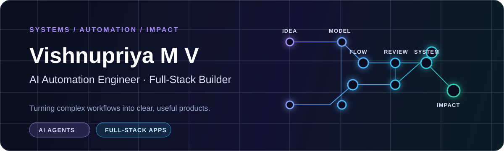

  

  <a href="#what-i-build">What I build</a> &nbsp;·&nbsp;
  <a href="#selected-work">Selected work</a> &nbsp;·&nbsp;
  <a href="#toolkit">Toolkit</a> &nbsp;·&nbsp;
  <a href="#proof-of-work">Proof of work</a> &nbsp;·&nbsp;
  <a href="#connect">Connect</a>

  
  
  

  
  
  
  

I’m **Vishnupriya M V**, an AI Automation Engineer and Computer Science Engineering student in Thrissur, Kerala. I build practical systems where AI, automation, and thoughtful product design meet—from agent-ready developer tooling to education and civic platforms people can actually use.

Currently: working with AI agents, LLM integrations, and business workflows at **Karv Devices**. I care about the part after the demo: clear flows, human review, and reliable outcomes.

---

## What I build

| Focus | How it shows up in my work |
| :-- | :-- |
| **AI systems & automation** | AI agents, LLM-assisted workflows, structured evaluation, workflow orchestration, and human approval paths. |
| **Full-stack products** | Role-aware dashboards, real-time workflows, APIs, authentication, data models, and deployment-ready applications. |
| **Education & civic technology** | Tools that make assessment, campus operations, and public services more visible and easier to act on. |
| **Computer vision & interactive web** | Browser-based OCR and vision experiments that turn camera input into useful, privacy-aware interactions. |

## Selected work

<table>
  <tr>
    <td width="50%" valign="top">
      <h3>🟣 01 — Rubriq</h3>
      
<strong>Assessment intelligence for handwritten examination workflows.</strong>

      
Connects question papers, answer keys, rubrics, handwritten submissions, evidence review, results, and learning insights—while keeping educators in control of the final evaluation.

      
Next.js · FastAPI · PostgreSQL · Multimodal AI · Evidence review

      
<a href="https://github.com/vishnupriya759285/rubriq_codex">Repository</a>

    </td>
    <td width="50%" valign="top">
      <h3>🔵 02 — Capability Forge</h3>
      
<strong>Compile APIs into safer task-level capabilities for AI agents.</strong>

      
Explores deterministic execution graphs, formal contracts, risk tiers, approval guards, MCP exposure, evaluation scenarios, and repair-oriented verification.

      
TypeScript · Next.js · Zod · MCP · Evaluation workflows

      
<a href="https://github.com/vishnupriya759285/capability_forge">Repository</a>

    </td>
  </tr>
  <tr>
    <td width="50%" valign="top">
      <h3>🟢 03 — Smart Rural Issue Management System</h3>
      
<strong>A digital civic-services workspace for rural panchayats.</strong>

      
Lets citizens report infrastructure issues, register for events by QR code, find welfare information, and gives officials a role-based workflow for action and communication.

      
TypeScript · Full-stack web · Supabase PostgreSQL · Vercel

      
<a href="https://github.com/vishnupriya759285/velookara">Repository</a> · <a href="https://velookara-w1vg.vercel.app">Live project</a> · <strong>1st Prize, TinkHerHack 4.0</strong>

    </td>
    <td width="50%" valign="top">
      <h3>🟠 04 — FixMyCampus</h3>
      
<strong>A traceable maintenance-resolution platform for campus operations.</strong>

      
Moves an issue from report to departmental assignment, work status, resolution, and verification, with role-specific views, notifications, analytics, image storage, and a defined state lifecycle.

      
Next.js · NestJS · GraphQL · Prisma · Supabase · Docker

      
<a href="https://github.com/vishnupriya759285/fixmycampus">Repository</a> · <a href="https://fixmycampus-steel.vercel.app">Live project</a>

    </td>
  </tr>
  <tr>
    <td width="50%" valign="top">
      <h3>🩷 05 — Ithinoru Pattu</h3>
      
<strong>A browser-based outfit-to-soundtrack experiment.</strong>

      
Uses on-device visual analysis and OCR to read color, lighting, and T-shirt text, then proposes multilingual music matches—with camera frames staying in the browser.

      
TypeScript · Vite · Tesseract.js · WebRTC · Web Audio

      
<a href="https://github.com/vishnupriya759285/coffee-coders">Repository</a> · <a href="https://coffee-coders-six.vercel.app">Live project</a>

    </td>
    <td width="50%" valign="top">
      <h3>Also exploring</h3>
      
<strong>From real-time mobile experiences to academic tooling.</strong>

      
My wider portfolio includes Bus Connect, a live bus-tracking app using Flutter, Firebase, GPS, and Google Maps; and ETLAB+ Smart Academic Advisor, recognised with a Best College Project Award.

      
<a href="https://vishnupriyamv.in/#projects">See the complete portfolio</a>

    </td>
  </tr>
</table>

## Toolkit

<table>
  <tr>
    <td valign="top"><strong>AI & automation</strong> AI agents · LLM integrations · workflow automation · n8n · Make · Zapier · prompt engineering</td>
    <td valign="top"><strong>Product engineering</strong> TypeScript · JavaScript · Python · Java · React · Next.js · Flutter · FastAPI · Node.js · NestJS</td>
  </tr>
  <tr>
    <td valign="top"><strong>Data & platform</strong> PostgreSQL · Supabase · Prisma · MongoDB · MySQL · Firebase · GraphQL · REST APIs</td>
    <td valign="top"><strong>Vision & delivery</strong> OpenCV · Tesseract.js · Docker · Git · GitHub · Vercel · Postman</td>
  </tr>
</table>

## Proof of work

<table>
  <tr>
    <td align="center" width="33%"><strong>9.66 / 10</strong> B.Tech CSE CGPA</td>
    <td align="center" width="33%"><strong>20+ hackathons</strong> Built, learned, and presented under pressure</td>
    <td align="center" width="33%"><strong>3 AI-focused internships</strong> Karv Devices · InternPe · AICTE / IBM SkillsBuild</td>
  </tr>
</table>

- **First Prize — TinkHerHack 4.0:** Smart Rural Issue Management System.
- **Top 5 finalist — Techlathlon:** selected from 100+ teams at ICT Kerala, Infopark.
- **Best College Project Award:** ETLAB+ Smart Academic Advisor.
- **IIT Bombay RDBMS — PostgreSQL:** 97.50%.

## Connect

If you’re building an AI automation, an agent workflow, or a product with a real operational problem behind it, I’d love to talk.

<a href="https://vishnupriyamv.in/"><strong>Portfolio ↗</strong></a>&nbsp;&nbsp;·&nbsp;&nbsp;<a href="https://www.linkedin.com/in/vishnupriya-m-v/"><strong>LinkedIn ↗</strong></a>&nbsp;&nbsp;·&nbsp;&nbsp;<a href="mailto:v74641001@gmail.com"><strong>Email ↗</strong></a>

Designed as a compact engineering portfolio—signal over noise.

